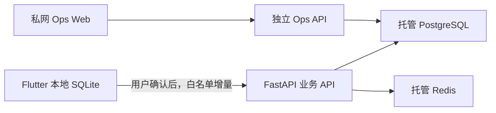

# TrainMate 内测核心后端部署与恢复

## 部署边界

业务后端保持 FastAPI 模块化单体。`VibeBase-main` 只用于参考 Vue 工程组织和聚合用量展示，不参与构建，也不复用其账号、支付、JWT、数据库表或启动建表逻辑。

生产拓扑为腾讯云 CVM 容器化 API、腾讯云 PostgreSQL 和腾讯云 Redis。业务 API 可由公网负载均衡接入；`ops-api` 与 `ops-web` 只能绑定 CVM 的 `127.0.0.1` 或私网地址，并通过 SSH 隧道访问。



## 发布顺序

1. 对 PostgreSQL 创建加密备份并记录可恢复时间点。
2. 用同版本镜像在隔离环境执行 `alembic upgrade head`，检查迁移日志。
3. 部署业务 API，保持 `SYNC_ENABLED=false`。
4. 部署独立 `ops-api` 和 `ops-web`，仅绑定 `127.0.0.1` 或私网。
5. 验证 `/healthz`、`/readyz`、四个聚合 Ops 接口、Redis 连通性和数据库连接；只有 `/readyz` 能证明数据库、Redis 与迁移版本同时就绪。
6. 小范围设置 `SYNC_ENABLED=true`，验证后再增加放量账号。
7. 为受控调度器配置 `python -m app.jobs.purge_deletions`，建议每小时一次；任务日志只保留聚合清理数量。

生产数据库只允许向前迁移。应用异常时先关闭 `SYNC_ENABLED` 并回退应用镜像，不自动执行 Alembic 降级。

## 私网运营台

本地容器配置把业务 API、Ops API 和 Ops Web 分别绑定到 `127.0.0.1:8000`、`127.0.0.1:8001` 和 `127.0.0.1:8081`。远程访问示例：

```bash
ssh -N -L 8081:127.0.0.1:8081 <CVM 用户>@<CVM 地址>
```

随后只从本机打开 `http://127.0.0.1:8081`。安全组不得开放 8001 和 8081。Ops API 只返回聚合用户数、同步健康、AI 用量与删除任务状态，不返回邮箱、训练明细、提示词、密钥或用户级列表。

## 备份与恢复演练

- PostgreSQL：启用自动备份和时间点恢复；上线前至少执行一次“恢复到新实例”的演练，不在原实例上覆盖恢复。
- Redis：只保存短期验证码、限流和关键写入保护状态，不作为业务事实源。恢复后必须验证生产失败关闭行为。
- 恢复演练：从备份创建新 PostgreSQL 实例，先以 `SYNC_ENABLED=false` 启动同版本 API，运行迁移与只读聚合检查，再切换测试流量。
- 验收证据：记录镜像摘要、迁移版本、备份时间点、恢复实例检查结果和验证时间；不得把数据库地址、口令或 Token 写入文档。

## 分阶段验收

第一段可以在没有公网域名时完成代码、迁移、容器和私网验证。域名、备案、TLS 证书、正式 SMTP、DeepSeek/MiniMax 生产密钥及云资源凭据均为外部前置条件。

第二段在这些条件就绪后验证公网 HTTPS、真实邮箱验证码、真实 AI 供应商调用、两台独立安装实例同步、导出和删除全生命周期。完成这些验证前，只能说明构建产物和本地验证通过，不能宣称内测后端已正式上线。

## 故障处理

- 同步异常：设置 `SYNC_ENABLED=false`，Flutter 继续本地训练；保留 outbox 等待恢复。
- Redis 异常：生产环境的验证码、刷新令牌、同步写入和 AI 写请求失败关闭，不切换到进程内状态。
- 数据冲突：服务端返回版本冲突；Flutter 保留本机与云端副本，必须由用户确认后解决。
- 删除任务异常：保持任务为 `pending` 并重试；不得提前删除匿名回执或缩短七天撤销期。
