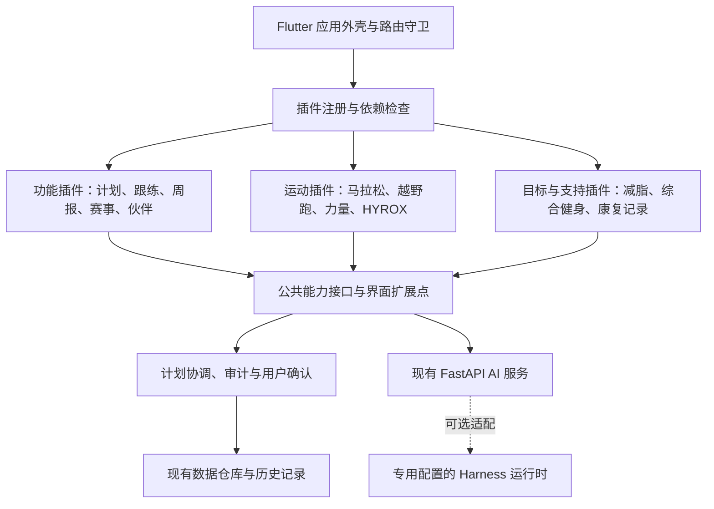
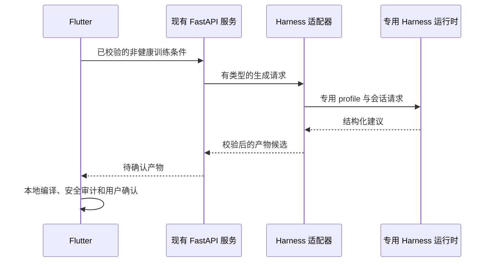

# TrainMate 功能与运动插件架构：DeepSeek Harness 源码对照方案

日期：2026-09-04。

状态：P0–P7 已实施并完成本地验收。实施结果见[插件化实施与验收记录](2026-09-04-trainmate-plugin-implementation.md)，日常扩展和故障恢复见[插件维护指南](2026-09-04-trainmate-plugin-maintenance-guide.md)。本文后续章节保留设计阶段措辞，用于解释决策来源；实际状态以上述实施记录为准。

最终实现采用 `goal.general_fitness` 表达综合健身，替代下文设计时拟议的 `program.general_fitness`。原 33 个业务目录之外新增 `core.capabilities` 管理目录，当前目录与发行定义均为 34 项。

## 1. 需求与本轮范围

用户要求：借鉴 DeepSeek Harness 的插件组织方式，将 TrainMate 的业务功能和每项运动分别组织为插件，并结合真实源码制定方案。

本轮交付是独立参考仓库与本文。未安装 Harness 依赖，未启动 Harness，未调用模型，未改变现有业务逻辑、数据库、API、认证、会员权益或健康数据处理规则。

首阶段设计假设：支持随应用发布的、经过审核的内置插件；配置决定启用范围。用户自行下载安装可执行插件、运行时更新移动端代码和插件市场不属于首阶段验收范围。

## 2. 源码基线与检查口径

| 项目 | 本次检查结果 |
|---|---|
| 上游仓库 | `https://github.com/deepseek-ai/deepseek-harness.git` |
| 本地参考目录 | `/Volumes/AI homeSSD/TrainMate/deepseek-harness` |
| 完整提交 | `d347e703908d0406b7a7ef80e3a0e594d86b2215` |
| 提交日期 | 2026-09-04 |
| 根包版本 | `0.1.3-alpha.1` |
| 源码运行环境声明 | Node `^22.19.0 || >=24.0.0`，pnpm `11.7.0` |
| TrainMate 工程 | `/Volumes/AI homeSSD/TrainMate/zhuque-flutter-main` |
| TrainMate 实际技术栈 | Flutter/Dart、Riverpod、GoRouter；Python/FastAPI 后端 |

参考目录是独立 Git 仓库，与 TrainMate 工程并列；它没有成为 TrainMate 的依赖或 Git 子模块。上游文件及许可证保持原样。

代码发现先使用现有知识图谱。Harness 尚未被索引；TrainMate 图谱有旧挂载路径和过时行数，因此本文中的实现判断以本次读取的磁盘源码为准。没有为本次分析重新建立全库索引。

## 3. 从 Harness 源码确认的机制

| 机制 | 源码入口 | 实际行为 | TrainMate 的对应设计 |
|---|---|---|---|
| 插件入口与依赖声明 | [registry.ts](../../../deepseek-harness/vendor/cordis/src/registry.ts)，`Plugin.Base`、`RegistryService.plugin` | 插件可用函数、类或 `apply` 对象表达；声明 `Config`、`inject`、`provide` | 定义明确的插件描述与依赖；业务调用公共能力接口 |
| 依赖变化触发生命周期 | [registry.ts](../../../deepseek-harness/vendor/cordis/src/registry.ts)，`Context.inject`；[fiber.ts](../../../deepseek-harness/vendor/cordis/src/fiber.ts) | 依赖决定插件是否加载；依赖改变会卸载并重新运行相关插件 | 首期在启动时校验依赖；在安全时点变更启用配置 |
| 可撤销的注册 | [fiber.ts](../../../deepseek-harness/vendor/cordis/src/fiber.ts)，`Fiber.effect` | 收集清理函数；同一复合 effect 内的清理按逆序执行；重复清理无效 | 页面入口、订阅、临时任务必须有明确清理责任 |
| 生命周期状态 | [fiber.ts](../../../deepseek-harness/vendor/cordis/src/fiber.ts)，`FiberState` | 区分等待依赖、加载、运行、失败、卸载、已释放 | 插件状态可观测；初始化失败撤回已完成的注册 |
| 能力注册与提供方替换 | [llm/index.ts](../../../deepseek-harness/packages/llm/llm/src/index.ts)，`LlmRuntime.registerAdapter` | 注册模型路由；重复路由拒绝；返回可释放和替换路由的句柄 | 运动策略按稳定 ID 注册；功能模块依赖能力，不绑定具体实现 |
| Skill 与插件的区别 | [skill/index.ts](../../../deepseek-harness/packages/skill/skill/src/index.ts)，`SkillRegistry.registerProvider`、`register` | Skill 注册由服务管理，有作用域、生命周期取消和缓存失效 | 专项知识是运动插件的一部分；一份知识文档不能代替业务插件 |
| 界面扩展点 | [ui-goal 客户端入口](../../../deepseek-harness/packages/client/ui-goal/src/client/index.ts)、[ui-slots](../../../deepseek-harness/packages/client/ui-slots/src/index.ts) | 插件声明客户端依赖，向命名插槽注册组件；注册可撤销 | 在 Flutter 中定义首页卡片、记录表单、周报分区等扩展点 |
| 客户端与宿主分开 | [ui-goal 宿主入口](../../../deepseek-harness/packages/client/ui-goal/src/index.ts) | 示例插件宿主入口无业务行为，界面实现在单独客户端入口 | 同一个逻辑插件可有 Dart 页面、Python 服务和可选 Harness 适配部分 |
| 按配置组合应用 | [profile.ts](../../../deepseek-harness/packages/boot/app-boot/src/profile.ts)、[app-boot/index.ts](../../../deepseek-harness/packages/boot/app-boot/src/index.ts) | profile 按顺序加载 bundle 与 patch；启动器负责应用组合 | 插件清单与装配集中管理，区分产品发行配置和用户功能偏好 |
| Python 接入方式 | [client.py](../../../deepseek-harness/python/sdk/src/deepseek_harness/client.py)，`HarnessClient.start`、`_default_launch_args` | 同步 JSON-RPC 客户端，通过子进程启动 `dsh --profile …`，要求显式 Harness home | 若后续实际接入 Harness，作为独立运行时适配，不视为纯 Python 库 |

需保留三个区别：

1. Harness 的架构文档明确说明包括核心服务在内都可由插件替换。TrainMate 可以把核心服务模块化，但生产组合必须保证身份、授权、安全校验和用户确认始终存在。这是 TrainMate 的产品约束，不是对 Harness 原生行为的描述。
2. `effect` 撤销的是运行时注册和资源。它不会自动撤销数据库写入、网络请求或已完成的训练记录。
3. 作用域和依赖注入不提供操作系统级安全隔离。首期运行经过审核的内置代码，不把注册器当作第三方代码沙箱。

## 4. TrainMate 当前需要改变的位置

| 当前入口 | 本次看到的实现 | 迁移要求 |
|---|---|---|
| [user_profile.dart](../../lib/data/models/user_profile.dart)，`MainSport` | 马拉松、越野跑、力量、HYROX、减脂、康复、综合健身共用枚举及序列化代码 | 首期保留原始代码，增加插件映射；不直接重命名历史数据 |
| [four_week_plan_generator.dart](../../lib/services/four_week_plan_generator.dart)，`_templatesFor` | 主运动通过集中分支选择模板；马拉松和越野跑目前共用分支 | 逐项迁出运动策略；越野跑初期保留当前行为，并明确当前专项能力范围 |
| 同文件，`_selectTemplates`、`_secondaryTemplate` | 次运动会替换最后一节模板；偏好处方和 ABC 力量周期有另一路径 | 新旧路径都必须覆盖；新增跨运动协调策略单独验收，不混入行为保持重构 |
| 同文件，`_WorkoutTemplate` | 生成器内部使用私有模板类型 | 在实际提取策略时定义最小共享类型或适配转换；不能从新插件直接访问旧私有类型 |
| [four_week_plan_controller.dart](../../lib/features/training_plan/application/four_week_plan_controller.dart)，`createDraft`、`activateDraft` | 生成、审计、激活与持久化有现成链路 | 插件输出接入这条链路；不新增可绕过确认的写计划入口 |
| 同文件，`_discoveredSkill`、`discoverSkillVersion` | 控制器记录一个发现的 Skill 版本 | 多插件来源必须有明确组合版本记录；不能直接删除单 Skill 限制就上线 |
| [training_skills.py](../../backend/app/services/training_skills.py)，`TrainingSkillRegistry.load`、`resolve` | 只允许一个主 Skill，按主运动加载已审核片段 | 分阶段演进知识提供方；保留审核、哈希、路径限制、来源收据与禁用机制 |
| [training_prescription_api_models.dart](../../lib/features/ai_center/data/training_prescription_api_models.dart)，`TrainingPrescriptionCapabilities.fromJson` | 客户端只接受能力契约版本 `1` | 新版本须做明确协商或版本化入口；不能单方面把现有响应改成版本 `2` |
| [training_prescription.py](../../backend/app/services/training_prescription.py) | 有类型枚举、请求校验、缓存、使用量记录和产物持久化 | 插件来源进入既有生成、缓存、确认链路；维持非健康上下文限制 |
| [app_router.dart](../../lib/app/router/app_router.dart) | 路由集中装配，并带身份和首次使用流程控制 | 业务路由逐步由注册表贡献；宿主统一保留路由守卫 |
| [weekly_report_service.dart](../../lib/services/weekly_report_service.dart) | 报告服务读取多种训练与身体数据 | 公共汇总继续共享；运动专项报告通过受控扩展点贡献 |

## 5. 目标结构与插件分类



每个业务能力都要有明确的插件归属。核心服务可以通过接口替换实现，但受生产组合约束，不能随意禁用。一个插件可以包含多个页面；同一个业务也可能跨现有的页面、服务和仓库目录。

### 5.1 运动和目标插件

以下 ID 为拟议内部 ID；右侧原有数据代码继续保留。

| 拟议插件 ID | 类型 | 当前对应代码 | 职责与兼容边界 |
|---|---|---|---|
| `sport.marathon` | 运动 | `marathon` | 路跑训练与马拉松目标；初期沿用现有赛事映射 |
| `sport.trail_running` | 运动 | `trail_running` | 独立运动身份；首期复用现有跑步模板，专项算法增强另行验证 |
| `sport.strength` | 运动 | `strength` | 力量模板、现有 ABC 周期接入和专项记录展示 |
| `sport.hyrox` | 运动 | `hyrox` | 专项编排与报告；通过公共接口复用耐力和力量基础能力 |
| `goal.fat_loss` | 目标 | `fat_loss` | 保留减脂入口，使用共享训练能力；目标可与运动组合 |
| `program.general_fitness` | 综合项目 | `general_fitness` | 保留综合健身入口和现有适用范围 |
| `support.rehab` | 支持能力 | `rehab` | 保留康复记录与既有保守流程；不赋予云端新的康复处方能力 |

后续每增加一项运动，都应增加独立的运动插件与验收用例。对尚无本地算法、云端枚举或记录结构支持的新运动，清单必须如实声明能力缺失；不能自动宣称已经支持个性化计划。

### 5.2 现有功能目录的拟议归属

以下覆盖本次枚举到的 33 个 `lib/features` 一级目录。目录归属是迁移清单，不代表直接移动目录就完成插件化。

| 现有目录 | 拟议归属与约束 |
|---|---|
| `auth`、`data_rights`、`profile` | 必需的身份、数据权利和基础档案模块；保留统一授权入口 |
| `cloud_sync` | 云同步功能插件；继续受既有同步授权和白名单约束 |
| `first_run_onboarding`、`onboarding` | 必需的首次使用编排；运动插件仅贡献经审核的专项资料项 |
| `dashboard` | 首页装配功能；运动和业务插件向已声明的卡片位置贡献内容 |
| `training_plan` | 计划功能插件；调用运动策略与统一计划协调器 |
| `guided_workout`、`workout_player`、`training_log` | 跟练与记录能力组；分别保留执行和记录责任，不复制每项运动的播放器 |
| `exercise_library`、`knowledge_library` | 动作和知识功能插件；运动插件贡献筛选、关联和审核知识 |
| `daily_adjustment`、`daily_check_in` | 每日调整与签到插件；安全判断仍在核心链路执行 |
| `weekly_report`、`user_insights` | 周报和洞察插件；支持运动专项的类型化报告分区 |
| `data_center`、`activity_import` | 身体数据和活动导入插件；写入沿用现有校验与确认 |
| `race_prep` | 赛事功能插件；由运动插件声明赛事类型和适配能力 |
| `meal_guide` | 饮食指导功能插件 |
| `motion_check` | 动作分析功能插件；运动插件只贡献当前支持的分析能力 |
| `rehab` | 对应支持插件的界面与记录部分；停用入口不关闭核心安全校验 |
| `reminders` | 提醒功能插件；资源清理不得影响其他插件拥有的提醒 |
| `starter_program` | 入门项目插件，使用运动策略和跟练功能 |
| `companion`、`pet`、`growth`、`rhythm` | 伙伴、宠物、成长、节奏功能组；先明确现有责任，再逐项迁移 |
| `ai_center`、`ai_coach` | AI 交互功能与旧入口兼容；工具调用只能产生受控结果 |
| `pilot_validation`、`self_use_acceptance` | 开发和验收插件，保留现有验收数据 |

### 5.3 一个运动插件的完整责任

每个运动插件声明以下能力；未实现的能力明确标为不可用：

- 专项资料：字段定义、校验和用途；新的持久化字段须另做迁移审查。
- 计划策略：当前可用模板、候选课程、阶段信息和约束。
- 训练内容：引用公共动作库，提供专项课程与器械匹配规则。
- 记录与指标：只注册已受支持的记录及报告接口，明确单位与版本。
- 界面贡献：首页卡片、专项设置、记录表单、周报分区。
- AI 能力：已审核知识、允许的输入输出、云端可用范围。
- 生命周期：启用、释放资源、失败处理、进行中任务处理和版本信息。

## 6. 拟议公共接口与装配规则

以下名称用于界定责任，尚未创建对应代码。

| 拟议接口 | 责任 |
|---|---|
| `PluginDescriptor` | 稳定 ID、插件类型、插件版本、宿主接口版本、依赖和提供能力 |
| `PluginRegistry` | 解析依赖、拒绝重复 ID、报告缺失依赖和循环依赖、组织初始化与清理 |
| `SportDefinition` | 运动身份、原有枚举代码映射、本地与云端可用能力 |
| `SportPlanStrategy` | 产生专项候选课程和约束，不直接激活或持久化有效计划 |
| `PlanCoordinator` | 调用当前主次运动策略，协调候选课程，交给既有审计与确认链路 |
| `FeatureContribution` | 注册路由、卡片、表单和报告位置；宿主决定是否展示和可访问 |
| `PluginContext` | 提供按责任划分的业务接口、资源清理和任务取消能力 |

设计要求：

1. 插件依赖公共能力，避免跨插件直接读取私有实现。HYROX 可复用耐力和力量基础能力，而不强制启用马拉松的全部页面或完整计划。
2. 对必需能力，重复提供方默认报错；替换必须在发行配置中显式表达。不能照搬 Harness Skill 同名条目“先注册者优先”的规则来处理运动身份。
3. 同一个逻辑插件可分别包含 Flutter、本地业务和后端 AI 部分。共享稳定 ID 和版本约定，不宣称跨 Dart、Python、TypeScript 共用一份可执行代码。
4. 使用现有 Riverpod、GoRouter 和仓库接口；先集中装配，再按独立演进需要决定是否拆 Dart package，不为每个插件立即增加独立包和部署单元。
5. 注册配置仅描述数据与受支持开关；首期不引入类似 `!!js` 的配置代码执行。
6. 运动策略返回结构化结果。没有 AI 的运动插件也能工作；每个插件不需要成为独立 Agent。

## 7. 生命周期与正在进行的任务

借鉴 Cordis 的依赖、状态和清理机制；首期只实现产品实际需要的生命周期，不逐项移植 Cordis。

- 启动前校验 ID、宿主接口版本、依赖和配置。必需核心能力缺失时阻止进入可写业务流程。
- 初始化分配的每项资源必须有清理函数。初始化失败时清理该插件已完成的注册，显示原因。
- 可选插件失败时，其入口显示不可用或撤下；依赖它的插件必须报告缺失能力。不能自动换成另一项运动并保存结果。
- 插件使用的订阅、计时器和进行中生成任务应绑定到其生命周期；异步结果落地前复核插件是否仍有效。
- 停用正在提供跟练能力的插件，须延后至训练结束，或经过明确的终止处理；不能在跟练中直接移除执行界面。
- 账户切换时释放账户相关状态，避免将上一账户缓存交给下一账户。
- 首期历史记录由公共数据层和通用阅读界面保留。关闭运动插件会停止新能力调用，不删除既有计划、日志和报告。

复合 effect 的逆序清理是 Harness 的具体实现之一。TrainMate 如需资源间的释放顺序，必须明确建模并测试，不能假定所有独立注册都有全局逆序保证。

## 8. 多运动计划和数据一致性

主运动和次运动分别提供候选内容，最终有效计划只经一个协调与确认链路生成。

第一阶段先保持现有主次运动行为，尤其是 `_selectTemplates` 的替换规则、处方偏好路径和 ABC 力量周期路径。后续若引入新的跨运动负荷协调算法，应作为独立行为变更，定义输入、指标含义和验收样例。

计划草稿需要能够追溯实际使用的运动插件、策略版本、知识版本和现有编译器版本。插件版本或可用状态变化时，未确认草稿应重新校验；旧计划的显示依赖已保存内容，不依赖在线重新生成。

本方案不新增数据库表，不修改现有字段或真实数据。后续如果持久化多插件来源超出现有模型能力，必须先列出具体表、字段或本地存储键、迁移、旧数据读取和回滚方案。内存中的注册清单不能替代持久化来源记录。

## 9. 如果直接接入 DeepSeek Harness 运行时

源码证明 Python SDK 可以启动独立的 Harness 进程并通过 JSON-RPC 通信，因此存在可验证的后端接入路径。但它不会自动把 Flutter 页面或 Python 业务转换为 Harness 插件。

拟议调用链：



从源码确定的接入约束：

- 使用受支持的 `dsh --profile …` 启动路径和明确的 `dsh_home`，与用户个人 Harness 配置隔离。
- Python `HarnessClient` 是同步客户端，且 `start()` 会复制父进程环境后覆盖配置值。接入异步 FastAPI 时需要受控工作线程或独立工作进程，不能阻塞请求事件循环；敏感环境隔离应在工作进程启动层完成，不能把传入 `env` 字典当成环境白名单。
- [sdk-minimal/cordis.patch.yml](../../../deepseek-harness/packages/bundle/sdk-minimal/cordis.patch.yml) 包含 `danger-full-access`、本地文件系统、子进程和终端配置。不能根据“minimal”名称直接把它作为 TrainMate 生产配置。
- 若实施，专用组合只注册实际需要的模型、知识和受控业务工具，验证没有宿主文件编辑、Shell 执行、自修改或插件自安装能力，并配合明确的进程权限与网络范围。
- 工具只返回建议或受控查询结果，不授予绕过用户确认的计划激活、数据删除或支付能力。
- 现有请求不发送健康数据的限制继续执行。Harness 会话、日志和缓存也要纳入数据保留与脱敏设计。
- 多用户的请求、会话、缓存、取消和资源配额必须隔离，不能直接复用个人助手的一棵全局插件树来承载所有用户状态。
- 固定运行时与 SDK 的匹配版本，并验证实际发布物；本次源码版本并不证明相应 npm 或 Python 包已可安装。
- Harness 故障时返回明确的生成失败；可以继续使用既有、已验证的本地能力，但不自动采纳未知结果。

实际启用前还需证明：模型请求取消、超时、进程退出、并发隔离、配置工具清单、产物校验、Token 记录以及日志不泄露数据。本文没有声称这些验证已经通过。

## 10. 架构决策记录

以下决策状态均为“提议”，不代表已实施。

### ADR-01：在现有技术栈中实现插件接口与装配

背景：移动端使用 Flutter，业务后端使用 FastAPI；Harness 是另一套宿主运行时和客户端体系。

提议：借鉴其服务定义、提供方、消费方、依赖和可清理注册机制，在现有技术栈中实现必要接口。实际使用 Harness 时，仅通过专用后端适配接入。

取舍：保留已有业务与验证资产，但需要维护跨运行时的 ID、接口和兼容关系。整体替换移动端或后端的代价与当前插件化目标不相称。

### ADR-02：按运动身份和功能能力分别注册插件

背景：运动策略集中在分支中，而跟练、报告等功能可被多项运动共用。

提议：每项运动有独立 ID、策略与能力声明；通用功能通过接口调用运动插件。减脂、康复、综合健身保留入口并标明其类型。

取舍：降低新增运动对公共功能的影响，但需要定义清晰的数据和界面扩展接口。每项运动复制一套 App 会增加数据与行为不一致的风险。

### ADR-03：首期只支持内置插件，保留旧协议和数据代码

背景：当前端云有封闭枚举、单 Skill 来源和严格版本解析，已有计划需要持续可读。

提议：第一步建立映射和装配；逐项提取现有策略，按原有协议输出。新增来源记录或协议版本时单独执行兼容设计。

取舍：新增运动的完整支持仍需应用发布和相应端云验收；收益是无需一次改写数据层和 API。

### ADR-04：先保持行为，再增强跨运动算法

背景：主次运动替换、偏好处方和专项周期已有不同路径。

提议：以新旧输出等价和原有测试为迁移门槛。跨运动协调算法、新专项模板和记录字段独立实施。

取舍：需要两阶段推进，但能区分结构迁移问题和训练业务变化。

## 11. 分阶段实施与验收

| 阶段 | 交付 | 可验证完成标准 | 回滚方式 |
|---|---|---|---|
| P0：源码对照 | 独立克隆、本文、源码定位 | 提交和根包版本可复核，文档链接有效，参考仓库保持干净 | 移除本次新增参考目录和文档即可；本轮不执行删除 |
| P1：注册骨架 | 插件描述、注册表、旧运动代码映射、显式发行组合 | 重复 ID、依赖缺失、循环依赖、初始化失败被识别；现有功能入口与计划输出不变 | 恢复旧装配入口；不涉及数据迁移 |
| P2：首个运动全链路 | 选择马拉松作为建议试点，接入计划、跟练和周报 | 覆盖默认模板和 AI 偏好路径；同输入保持原有输出；停用不损坏历史记录；其他运动无回归 | 保留原策略适配入口，按配置退回旧实现 |
| P3：其余运动与功能迁移 | 越野跑、力量、HYROX及目标/支持插件；逐项迁移功能表 | 每项能力有独立测试和兼容声明；ABC 力量周期、混合运动、赛事映射与数据确认流程保持正确 | 按插件回退；不删除旧数据与已有能力 |
| P4：端云多插件契约 | 能力发现、组合来源、缓存与确认版本校验 | 新旧客户端兼容；插件升级/撤销使未确认草稿正确失效；已保存记录可读 | 保留旧服务契约；任何数据变更需先有独立回滚方案 |
| P5：可选 Harness 接入 | 专用 profile、受限工具和运行时适配器 | 先无密钥合成用例，再做明确授权的真实模型验证；满足第 9 节要求 | 关闭该适配器，保留既有服务和已保存结果 |

P2 是建议试点，不代表马拉松已经插件化。P3 才逐步覆盖所有现有运动与功能；各阶段不能互相替代验收。

## 12. 后续实现时的验证入口

以下是当前已经存在的测试文件，列出作为迁移回归入口；本轮没有运行它们。

```sh
flutter test test/services/four_week_plan_generator_test.dart test/features/training_plan/application/four_week_plan_controller_test.dart test/features/dashboard/four_week_plan_training_bridge_test.dart
flutter test test/services/training_prescription_safety_audit_service_test.dart test/data/models/plan_generation_preferences_test.dart test/features/ai_center/data/ai_training_prescription_api_test.dart
flutter test test/services/weekly_report_psychology_test.dart test/features/weekly_report/weekly_psych_check_in_test.dart
flutter analyze
```

后端在现有项目虚拟环境中运行：

```sh
python -m pytest tests/test_training_prescription.py tests/test_training_prescription_v2.py
```

新增注册器需要有意义的生命周期测试：失败清理、重复释放、失效异步结果、依赖变化、账户隔离，以及停止或禁用时的数据保留。运动迁移覆盖同一主运动、次运动、偏好处方和赛事条件下的新旧输出；UI 还要验证当前页面所属插件停用时的回退行为。

自动测试通过后，分别进行模拟器导航、跟练、记录和历史报告检查。真实模型调用与线上服务验证必须单独记录，不能以本地测试代替。

## 13. 本轮完成与未完成

- 已克隆并确认上述 Harness 提交，读取注册、生命周期、模型提供方、Skill 注册、界面插槽、profile 和 Python SDK 源码。
- 已对照 TrainMate 的运动枚举、计划生成、主次运动选择、审计确认、单 Skill 版本和客户端契约。
- 已新增本文，给出插件归属、接口责任、实施阶段和验收标准。
- 本轮验证仅包括克隆结果、源码与文档定位、文档格式及工作区差异检查：22 个文档链接均有效，33 个功能目录均被归属表覆盖，提交与根包版本匹配，参考仓库干净；TrainMate 原有已跟踪差异统计未改变。
- 尚未实现插件注册器、运动策略提取、功能注册迁移或 Harness 运行时接入；未运行 Flutter、后端或 Harness 测试，也未做模拟器和真实模型验证。
