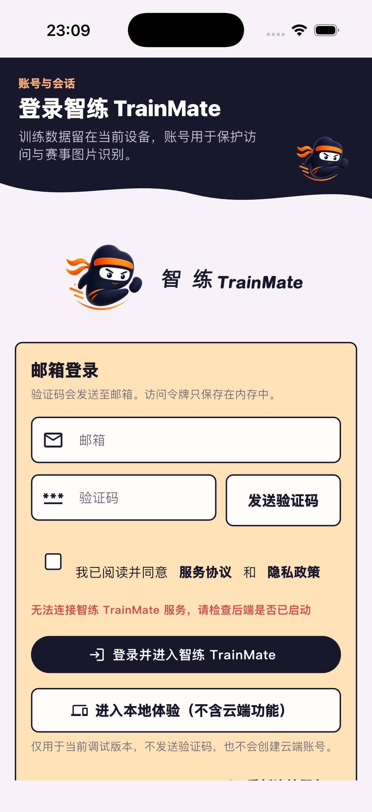
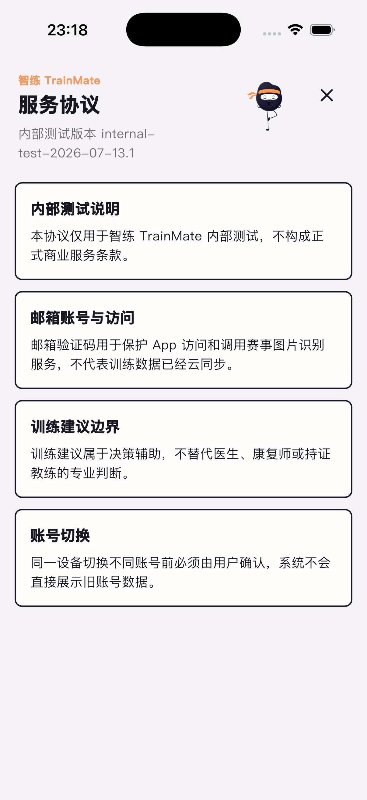

# TrainMate 移动端 App 双轨检查

- 检查日期：2026-07-19（America/Los_Angeles）
- 源码版本：`3b541ff0145e4412ec42696eff3773fbb1d9eafb`
- 检查范围：登录、本地体验、今日训练、训练计划、动作检测、数据中心、个人页
- 数据边界：不清理已有模拟器、不删除训练记录、不提交训练或健康数据
- 设计审查方法：`emil-design-eng`

## 结论

当前源码能够通过静态检查、iOS 模拟器构建及 31 项核心定向测试，但还不能判定移动端核心流程已经端到端可用。

已安装版和当前源码的登录页均能真实渲染；已安装版显示后端不可达。当前源码安装到含旧数据的模拟器后进入只读恢复状态，证明数据保护兜底生效，但也暴露升级/旧数据兼容风险。空白模拟器可正常显示登录页和服务协议；由于 `serve-sim` 持续报 `encodingFailed`，输入转发未建立，未取得“真实点击遍历全部核心页面”的证据。

## 证据分层

| 证据层 | 结果 | 能证明什么 | 不能证明什么 |
| --- | --- | --- | --- |
| 已安装包 | 已启动，登录页可见 | 安装包存在、能启动、首屏能渲染 | 后端可用、核心流程可完成 |
| 当前源码构建 | `flutter build ios --simulator --debug --no-pub` 成功 | 当前工作树可生成 iOS 模拟器 App | 真机发布可用、生产签名有效 |
| 空白模拟器 | 登录页、服务协议可见 | 新安装首屏与协议路由可渲染 | 全部页面已被真实点击遍历 |
| 旧数据模拟器 | 进入只读恢复提示 | 数据库失败时未强行读取旧副本 | 旧数据升级一定成功 |
| 定向测试 | 31 项通过 | 登录、本地体验、导航、今日训练、计划、动作检测、数据中心等代码路径符合断言 | 后端、相机、HealthKit、真实触控体验可用 |
| 后端 | 登录页提示服务不可达 | 当前测试环境无法连接 TrainMate 服务 | 服务代码本身故障或生产不可用 |

## 关键问题

### P0：旧数据环境可能无法打开本地数据库

当前源码安装到原有 `TrainFlow iPhone 17 Pro` 后显示：

> 本地数据库暂时无法安全打开。为保护训练数据，已进入只读恢复状态，未读取陈旧设备副本。

这是正确的数据保护行为，但会阻断正常使用。上线前需要用可复制的旧库样本验证 schema、迁移和只读恢复后的恢复路径，不能通过清库绕过。

### P1：登录依赖的后端不可达

已安装版和空白源码环境的登录页均显示“无法连接智练 TrainMate 服务，请检查后端是否已启动”。邮箱验证码、云端账号和赛事图片识别无法在本轮验证。

### P1：本地体验入口存在未披露的本地清理副作用

`AuthController.enterLocalPreview()` 会先调用 `_clearPreExerciseClearance()`，随后清理令牌。页面只说明“不发送验证码，也不会创建云端账号”，没有说明会清除运动前确认状态和令牌。对于“保留现有数据”的 QA 约束，这个入口不能直接点击。

建议把副作用写入确认文案，或将“预览会话建立”和“清理账号相关状态”拆开。

### P1：跨平台应用标识仍是示例值且不一致

| 平台 | 当前标识 |
| --- | --- |
| iOS | `com.example.zhuqueFlutterDemo` |
| Android | `com.example.trainflow_ai` |

这会影响商店身份、深链、推送、钥匙串/安全存储和后续迁移。需要在发布前统一为正式反向域名，并设计旧安装的数据迁移方案。

### P2：模拟器浏览器镜像无法编码帧

`serve-sim` 已绑定到明确 UDID，但持续输出 `error encoding frame: encodingFailed`；页面只有连接状态，未形成真实画面和输入通道。系统截图正常，因此这是 QA 镜像基础设施问题，不是 App 白屏证据。

## 交互与动效审查

项目是 Flutter App，不使用 CSS。下面给出可直接修改的 Dart/Flutter 等价建议；按 `emil-design-eng` 要求使用 Before/After 对照。

| Before | After | Why |
| --- | --- | --- |
| `entrance = 220ms`，叠加最多 `100ms` stagger，总时长可达 `320ms` | `entrance = 180ms`，单项间隔 `35ms`，总延迟上限 `70ms` | 高频页面进入应保持在 300ms 内，避免内容“排队出现” |
| 路由进入和退出均为 `220ms` | 进入 `200–220ms`，退出 `150–170ms` | 返回是系统响应，应比进入更快 |
| 路由 `reverseCurve: Curves.easeInCubic` | 使用 `Curves.easeOutCubic`，或 `Cubic(0.23, 1, 0.32, 1)` | `ease-in` 在用户最关注的起始阶段显得迟钝 |
| 可点击卡片只有 `InkWell` 水波纹 | `onHighlightChanged` 驱动 `AnimatedScale(scale: pressed ? 0.97 : 1, duration: 120ms)` | 提供即时按压反馈；已有 `TrainFlowMotion.button = 120ms` 可复用 |
| 每个 `TrainFlowPage` 的 organic header 都执行一次 6 秒 ClipPath 呼吸 | 高频主页面使用静态曲线；只在首次引导/低频庆祝场景启用呼吸 | 频繁、长时间的装饰动效容易拖慢感知速度，ClipPath 还会持续触发绘制 |
| 登录页同时展示顶部小角色和中部大品牌角色 | 保留一个主品牌锚点，另一个改成更小的状态型角色或移除 | 减少视觉竞争，让邮箱登录与本地体验成为首要任务 |
| 本地体验按钮与正式登录同处高权重区域，但副作用未说明 | 在按钮下明确“将退出现有账号并重置运动前确认状态”，必要时增加确认页 | 交互文案必须覆盖真实副作用，避免用户误以为完全无状态变化 |
| 全局已检查 `MediaQuery.disableAnimations` | 保留淡入/颜色变化，禁用位移、呼吸和角色移动 | 当前 reduced-motion 基础正确，进一步按“少运动而非无反馈”细化 |

建议优先修改路由退出曲线、stagger 总时长和本地体验副作用文案；这三项改动小、风险低、体感收益明确。

## 核心流程覆盖

| 流程 | 可见证据 | 测试证据 | 本轮结论 |
| --- | --- | --- | --- |
| 登录 | 已安装版和空白源码登录页可见 | 邮箱验证码、本地体验登录测试通过 | UI 可渲染；后端登录未通过 |
| 本地体验 | 入口可见 | Debug 登录页同意协议后进入本地体验通过 | 代码路径通过；因数据边界未在已有安装版点击 |
| 今日训练 | 未取得真实页面截图 | 393 × 852 下四分区无遮挡测试通过 | 布局断言通过，真实触控未验证 |
| 训练计划 | 未取得真实页面截图 | 计划生成页面测试通过 | 代码路径通过，端到端生成未验证 |
| 动作检测 | 未取得真实页面截图 | 动作检测位于动作库且导航选中状态正确；图片分析控制器测试通过 | 路由和控制器通过，相机/真实图片未验证 |
| 数据中心 | 未取得真实页面截图 | 数据中心页面测试通过 | 页面代码通过，真实健康数据未提交 |
| 个人页 | 未取得真实页面截图 | 健康管理入口、训练负荷曲线、训练时间排期测试通过 | 主要入口通过，真实 HealthKit 权限未验证 |

## 截图

### 已安装版登录页

### 当前源码空白模拟器登录页

### 当前源码旧数据只读恢复

### 当前源码服务协议

## 验证记录

| 命令/检查 | 结果 |
| --- | --- |
| `flutter analyze --no-pub` | 通过，`No issues found!`，3.4 秒 |
| `flutter build ios --simulator --debug --no-pub` | 通过，Xcode build 21.5 秒 |
| 6 个核心测试文件的 `flutter test --no-pub ...` | 临时镜像中 31 项全部通过 |
| 原工作树直接运行定向测试 | 未进入测试；外置卷 AppleDouble 文件导致 `build/native_assets/macos/._native_assets.json` 删除失败 |
| iOS 插件构建提示 | `flutter_secure_storage`、`health` 尚不支持 Swift Package Manager；当前为警告，未来 Flutter 版本会变成错误 |

临时镜像位于 `/private/tmp/trainmate-mobile-qa.Y6FV0U`，没有覆盖或清理原工作树数据。

## 下一步建议

1. 使用脱敏旧数据库 fixture 复现只读恢复并验证迁移，不清理原模拟器。
2. 启动本地后端后补跑验证码登录和赛事图片识别，单独记录服务端证据。
3. 修复 `serve-sim` 的帧编码后，在空白模拟器真实点击遍历七条核心流程，并补齐页面截图。
4. 发布前统一 iOS/Android 正式应用标识，制定安全存储与本地数据库迁移方案。
5. 先以小 diff 修改路由退出曲线、stagger 上限和本地体验文案，再跑现有 31 项测试。
